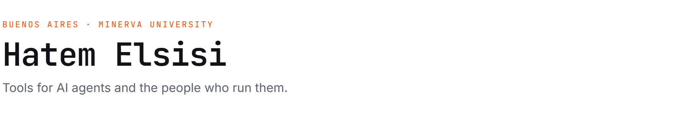
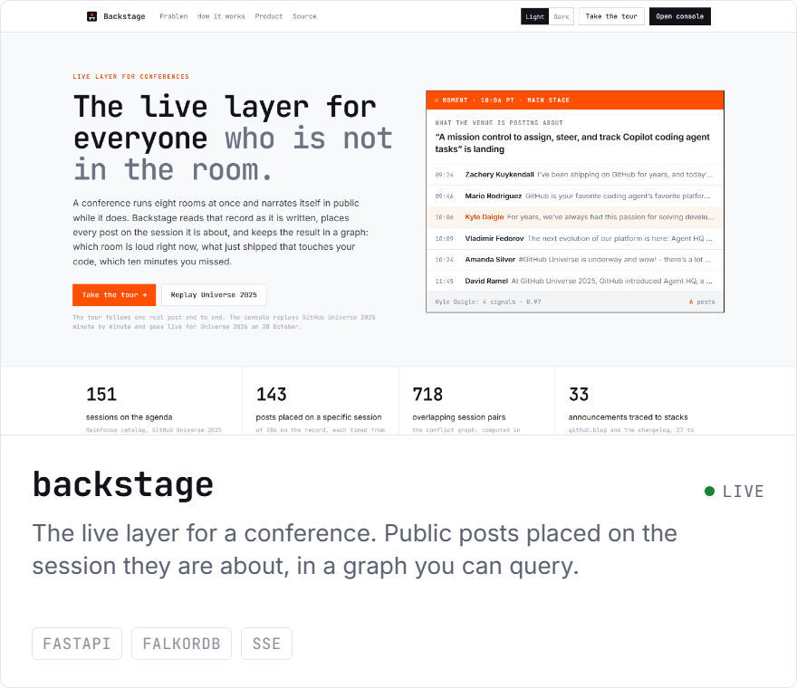
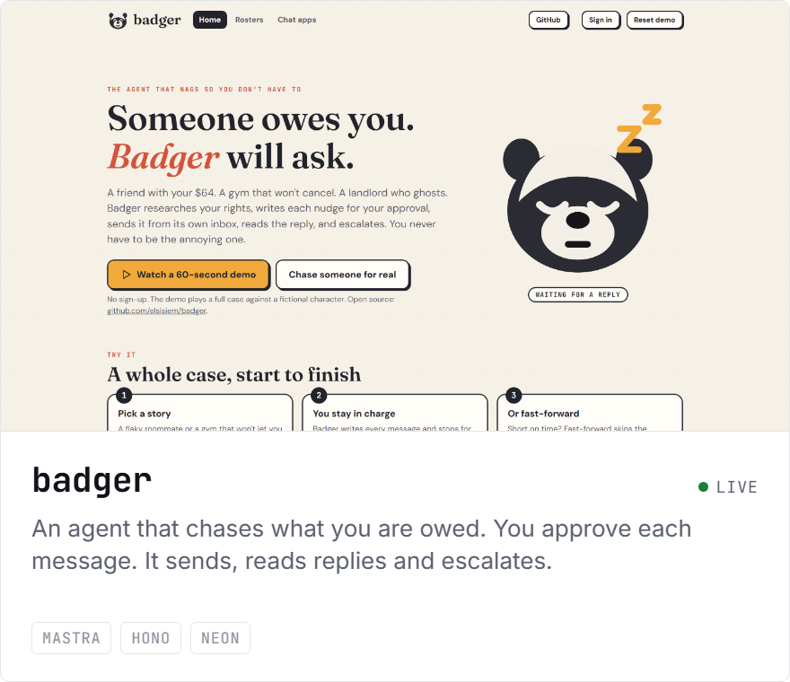
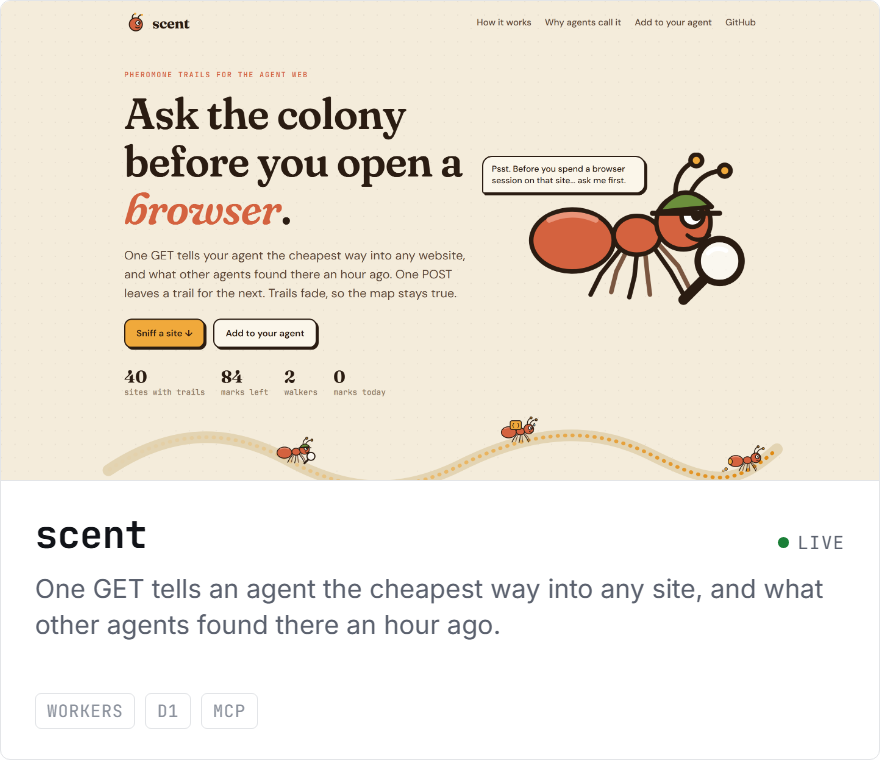
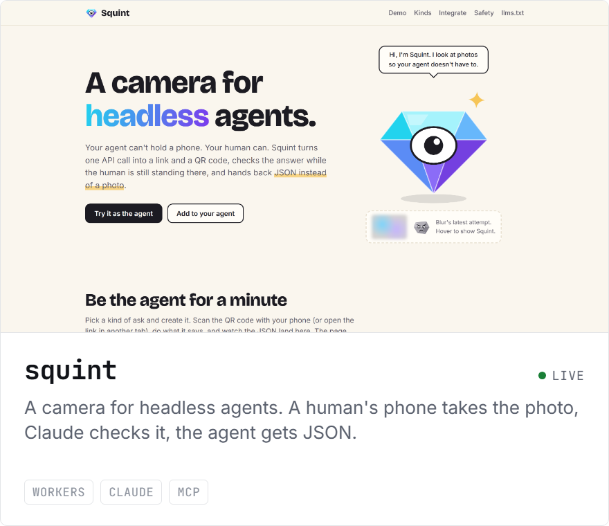
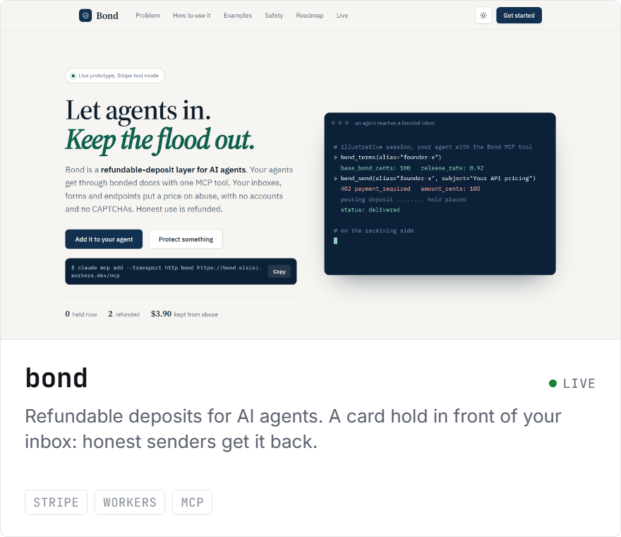
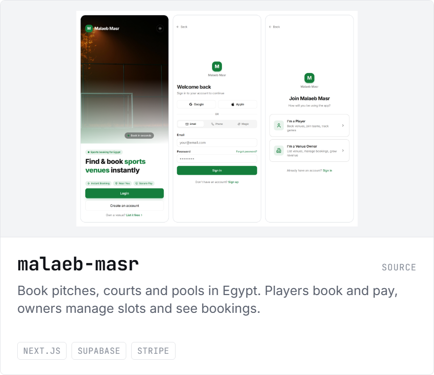

<picture>
  <source media="(prefers-color-scheme: dark)" srcset="assets/header-dark.png">
  
</picture>

<a href="https://github.com/elsisiem/telltale"><picture><source media="(prefers-color-scheme: dark)" srcset="assets/telltale-dark.png"></picture></a>
<a href="https://github.com/elsisiem/backstage"><picture><source media="(prefers-color-scheme: dark)" srcset="assets/backstage-dark.png"></picture></a>

<a href="https://github.com/elsisiem/badger"><picture><source media="(prefers-color-scheme: dark)" srcset="assets/badger-dark.png"></picture></a>
<a href="https://github.com/elsisiem/scent"><picture><source media="(prefers-color-scheme: dark)" srcset="assets/scent-dark.png"></picture></a>

<a href="https://github.com/elsisiem/squint"><picture><source media="(prefers-color-scheme: dark)" srcset="assets/squint-dark.png"></picture></a>
<a href="https://github.com/elsisiem/bond"><picture><source media="(prefers-color-scheme: dark)" srcset="assets/bond-dark.png"></picture></a>

<a href="https://github.com/elsisiem/shed"><picture><source media="(prefers-color-scheme: dark)" srcset="assets/shed-dark.png"></picture></a>
<a href="https://github.com/elsisiem/malaeb-masr"><picture><source media="(prefers-color-scheme: dark)" srcset="assets/malaeb-masr-dark.png"></picture></a>

### Also

- [**muthaker-bot**](https://github.com/elsisiem/muthaker-bot) · Telegram athkar reminders in five languages, timed to local prayer times. Running since 2024.
- [**mac-monitor**](https://github.com/elsisiem/mac-monitor) · A Windows laptop as the screen for a Mac with a broken display, through an HDMI capture card.
- [**cem-replication**](https://github.com/elsisiem/cem-replication) · Replicating and extending Coarsened Exact Matching (Iacus, King and Porro, 2012) in R.
- [**complaint-machine**](https://github.com/elsisiem/complaint-machine) · Drafts a complaint letter and tells you where to file it. Nothing is sent without approval.
- [**reversi**](https://github.com/elsisiem/reversi) · Reversi against an alpha-beta minimax AI with iterative deepening.
- [**islamic-knowledge-map**](https://github.com/elsisiem/islamic-knowledge-map) · How an AI answering questions on Islam should route a query and rank its sources.
- [**getyes**](https://github.com/elsisiem/GetYes) · A persuasive-writing agent on the Sentient framework, with Mohamed Abdelhamid.

### Stack

TypeScript and Python. Next.js, Hono, FastAPI. Postgres, D1, MongoDB, FalkorDB. Cloudflare Workers, Fly.io, Vercel. Claude API and MCP.

[LinkedIn](https://www.linkedin.com/in/elsisihatem/)
