

<a href="https://github.com/elsisiem/telltale"></a>
<a href="https://github.com/elsisiem/backstage"></a>
 

<a href="https://github.com/elsisiem/badger"></a>
<a href="https://github.com/elsisiem/scent"></a>
 

<a href="https://github.com/elsisiem/squint"></a>
<a href="https://github.com/elsisiem/bond"></a>
 

<a href="https://github.com/elsisiem/shed"></a>
<a href="https://github.com/elsisiem/malaeb-masr"></a>
 

<a href="https://github.com/elsisiem/mac-monitor">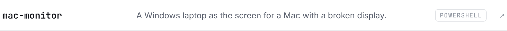</a>
<a href="https://github.com/elsisiem/cem-replication">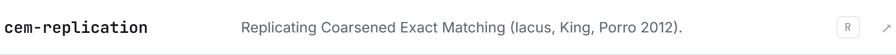</a>

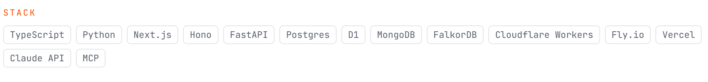

